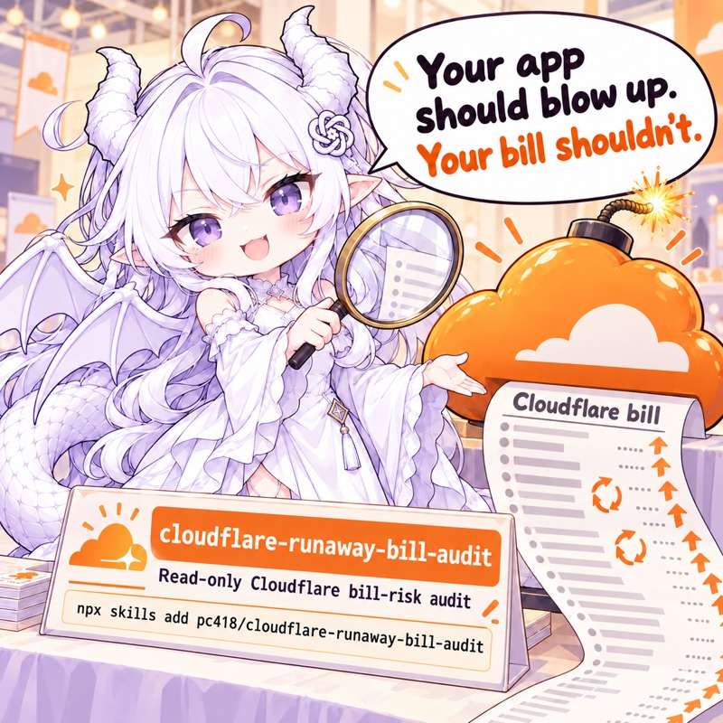

# cloudflare-runaway-bill-audit

<p align="center"></p>

[中文说明](README.zh-CN.md)

An agent skill that checks whether a Cloudflare project can run up a surprise bill. It looks
for the mistakes behind real runaway-bill incidents (a Durable Object alarm that re-arms
forever, a queue consumer that re-enqueues itself, a catch-all route that starts a container
for every favicon request) and writes a single-file HTML report plus a Markdown handoff for a
coding agent.

It works in two parts: a deterministic `scan` collects configuration and account facts, and
the agent running the skill reads the application source and records what it found. Supports
Cloudflare only: Workers, Durable Objects, Queues, R2, Containers/Sandbox, Browser Run, Images
and Workers AI.

The audit is **read-only**: it never deploys, never changes the account, never writes into the
scanned project and never calls application endpoints that perform paid work.

**Credits.** The skill was written by Astra (GPT-6 Astra). The incident stories come from
[serverlesshorrors.com](https://serverlesshorrors.com/), a collection of serverless bill
stories; thanks to its maintainers.

**Recommended model.** Run this skill with GPT-6 Astra (`gpt-6-astra`) at `xhigh` reasoning
effort.

## Install

With the [skills CLI](https://github.com/vercel-labs/skills):

```bash
npx skills add pc418/cloudflare-runaway-bill-audit
```

Or clone this repository into your agent's skills directory (for Claude Code,
`~/.claude/skills/cloudflare-runaway-bill-audit` or `<project>/.claude/skills/...`). It needs
Python 3.11+ and nothing else (standard library only).

## Usage

Ask your agent "can this project blow up my Cloudflare bill?". The agent follows
[SKILL.md](SKILL.md):

```
scan (deterministic facts)  ->  agent audit (edits findings.json)  ->  render (HTML + Markdown)
```

1. **Scan.**

   ```bash
   python3 scripts/audit.py scan path/to/project                 # config + source context, no network
   python3 scripts/audit.py scan path/to/project --account       # + read-only account checks
   python3 scripts/audit.py scan path/to/project --account-wide  # account checks for every Worker / bucket
   ```

   The scan reads every `wrangler.toml` / `wrangler.json` / `wrangler.jsonc` in the project
   (outside `node_modules` and dot-directories, including each `[env.*]` override), each
   Worker's declared entry paths and whether they exist, and the Git HEAD and dirty state. It
   does not read application source. With `--account` it also runs live, read-only checks of
   the Cloudflare account. It writes `findings.json` and a first report marked **unreviewed**.

2. **Agent audit.** The agent maps entry points and paid sinks in the source, traces each
   paid path (admission, paid attempts, delivery, retries) with
   [the incident-mechanism guide](references/agent-detection.md), checks suspected risks
   against the actual controls, and corrects or adds evidenced findings in `findings.json`.
   [Dated runtime notes](references/runtime-evidence.md) cover cache layers and cancellation.
   Only then does it set `audit_status` to `reviewed`.

3. **Validate and render.**

   ```bash
   python3 scripts/audit.py validate /tmp/nobill-report-xxxx/findings.json
   python3 scripts/audit.py render /tmp/nobill-report-xxxx/findings.json
   ```

A scan alone is not an audit: its empty inventory and zero alarms say nothing about the
application. `reviewed` records that the agent's investigation happened, with its scope; it
does not certify the project as safe.

Options and behaviour:

- A project needs a wrangler config or a Cloudflare dependency to be scanned. Use
  `--provider cloudflare` to scan a project without those markers. If the scan refuses and some
  paths could not be read, the error names them (the project may still be a Cloudflare
  project).
- `--out DIR` chooses the output directory, which must be outside the project. By default a new
  directory under the system temp dir is created; if that is inside the project, the scan stops
  and asks for `--out`. `render --out FILE.html` writes `FILE.md` next to it.
- `--account-id` (or `CLOUDFLARE_ACCOUNT_ID`) picks the account when the credential can read
  more than one.
- Outputs are checked before anything is written: an output path that resolves into the
  project (a symlink, say), or an `--out` that names the same file as another output or the
  findings file (names differing only in case count as the same), stops the command. Files are
  written to a temp file and moved into place, so a link at the destination is replaced, never
  written through.
- Both `scan` and `render` redact known local Cloudflare credentials (`CLOUDFLARE_API_TOKEN`,
  `CLOUDFLARE_API_KEY`, the wrangler login's OAuth and refresh tokens, valid or not) from all
  three outputs. This is not a general secret detector: third-party credentials and signed URLs
  must be sanitized before entering audit evidence.

## Outputs

Written side by side in the output directory; both commands end by printing the three absolute
paths, labelled, as their last lines.

- `report.html`: the full report for a person (light/dark, phone-width, self-contained).
- `report.md`: a compact handoff for a coding agent that will fix things. It holds the same
  findings in the same order as the HTML: each with its finding id, rule, target, evidence
  (`file:line` with the snippet, API field and value), review decision, why, fix and doc URLs.
  Project text in it is neutralised (no injected headings, links, autolinked URLs or emails, or
  HTML).
- `findings.json`: the data both are built from; the agent edits it. The format is documented
  in [references/findings-schema.md](references/findings-schema.md).

The report lists:

- **Alarms**: must fix. An evidenced repeatable or amplified cost with no effective bound.
- **Suggestions**: better fix, each with a best-practice instruction and a doc link.
- **Unknowns**: what could not be checked, and the exact permission or fact that would settle
  it.
- **Passed checks**, a **scope-requirements** table, the agent's **paid-work inventory** with
  the controls on each path, the **audit status and review summary**, and the **incident
  references** the findings cite.

## What it checks

### What the agent investigates

The [incident-mechanism guide](references/agent-detection.md) gives causal questions,
contrasting cases and decisive evidence for each class. Incidents on other providers teach the
mechanism, not Cloudflare prices. The Moltbot case is a Cloudflare Sandbox incident where a
catch-all route started a container for every static asset (a user-supplied summary; the
original post was not fetched).

| Class | Mechanism | Incidents |
|---|---|---|
| C1 | Autonomous and cross-service repetition: Durable Object alarms that re-arm, queue consumers that re-enqueue, self-calls, workflows, timers and background tasks | [cloudflare-108k](https://serverlesshorrors.com/all/cloudflare-108k), [cloudflare-88k](https://serverlesshorrors.com/all/cloudflare-88k), [cloudflare-36k](https://serverlesshorrors.com/all/cloudflare-36k), [firebase-cloudrun-72k](https://serverlesshorrors.com/all/firebase-cloudrun-72k), [vercel-3k](https://serverlesshorrors.com/all/vercel-3k) |
| C2 | Work amplification and storage growth: per-item operations, unbounded lists and scans, retained data | cloudflare-36k, [firebase-70k](https://serverlesshorrors.com/all/firebase-70k), [bigquery-22k](https://serverlesshorrors.com/all/bigquery-22k) |
| C3/C6 | Repeatable paid endpoints and budget races: AI, email/SMS, browser, container and external paid APIs reachable by anonymous or ordinary users; exemptions, fail-open guards, post-work debits | [mailgun-11k](https://serverlesshorrors.com/all/mailgun-11k), [vercel-23k](https://serverlesshorrors.com/all/vercel-23k), cloudflare-36k |
| C4 | Public objects and alternate delivery paths: cache bypass, public bucket domains, signed URLs, uploads, transformations | [firebase-100k](https://serverlesshorrors.com/all/firebase-100k), [netlify-104k](https://serverlesshorrors.com/all/netlify-104k), [aws-13k](https://serverlesshorrors.com/all/aws-13k) |
| C5/C10 | Catch-all and repeated compute: stray requests starting containers, expensive generation on GET/SSR without an early cache hit | Moltbot (user-supplied summary), [vercel-620](https://serverlesshorrors.com/all/vercel-620), [vercel-96k](https://serverlesshorrors.com/all/vercel-96k), [vercel-46k](https://serverlesshorrors.com/all/vercel-46k) |
| C6 | Resource lifetime and execution ceilings: container/browser/sandbox cleanup and idle, instance ceilings, output caps, Gateway coverage | Moltbot, firebase-cloudrun-72k |
| C7 | Client lifecycle, analytics and recovery: per-render/mount events, reconnects, retries in browser and native clients | [posthog-devin-1273](https://serverlesshorrors.com/all/posthog-devin-1273) |
| C8 | Visibility versus enforced brakes: alerts notify, ceilings stop work | the three Cloudflare usage incidents, all found from the invoice |
| C9 | Billing-model assumptions: SKU, plan, included allocation, automatic upgrades, external billing units | [cloudflare-images-400](https://serverlesshorrors.com/all/cloudflare-images-400), [aws-103](https://serverlesshorrors.com/all/aws-103), [webflow-1k](https://serverlesshorrors.com/all/webflow-1k) |
| LOG | Log and telemetry multiplication: per-item logs, tail consumers writing to metered sinks | no incident; provider log pricing |

### What `scan` checks

These rules come from configuration and the account API. Each states the checked setting and
its source; a configuration fact does not certify what the code does. Binding-cost tables cover
declared Cloudflare products only, not external SDK/HTTP spend.

| Class | Rule | Severity | Based on |
|---|---|---|---|
| C1 | `CF-QUEUE-CONSUMER-BOUNDS`: consumer without explicit `max_retries` / `dead_letter_queue` (config and live consumer settings). Retry settings do not bound application re-enqueue | suggestion | cloudflare-36k |
| C1 | `CF-SELF-SERVICE-BINDING`: a service binding to the Worker itself (needs review) | suggestion | firebase-cloudrun-72k |
| C3 | `CF-NO-RATELIMIT-BINDING`: paid bindings with no Rate Limiting binding (a declared binding does not prove it runs on the paid path) | suggestion | cloudflare-36k, mailgun-11k |
| C3 | `CF-WORKERS-DEV-ON`: workers.dev / preview URLs on for a Worker with paid bindings (config and live) | suggestion | cloudflare-36k, firebase-100k |
| C3 | `CF-AI-GATEWAY-SPEND` (account): no AI Gateway with spend limits; collected whenever the account layer runs, without claiming any call is routed through it. Certain when the config declares an AI binding or with `--account-wide`, otherwise needs review | suggestion | cloudflare-36k |
| C4 | `CF-R2-DEV-PUBLIC` (account): r2.dev public access enabled | suggestion | firebase-100k, aws-13k |
| C5 | `CF-RUN-WORKER-FIRST`: `run_worker_first` or Pages `_routes.json` covers every path, so every asset request runs the Worker; the agent judges whether those requests start expensive work (needs review when the Worker has Containers, Browser Run or Durable Objects) | suggestion | Moltbot, vercel-620 |
| C6 | `CF-CONTAINER-MAX-INSTANCES` (config and deployed; never escalated to an alarm), `CF-CONTAINER-SIZE`, `CF-CPU-LIMIT`, `CF-SUBREQUESTS-RAISED`, `CF-QUEUE-CONCURRENCY`. Per-invocation and instance caps do not bound total spend | suggestion | firebase-cloudrun-72k, Cloudflare's pricing guidance |
| C8 | `CF-NO-BILLING-ALERT` (account; unknown when no enabled cost-alert policy is listed or without Notifications Read), `CF-USAGE-SNAPSHOT` (last-24h usage) | unknown / suggestion | all three Cloudflare usage incidents were found from the invoice |
| C9 | `CF-COST-INVENTORY`: what each binding bills by and where the free allocation ends; `CF-CONFIG-DRIFT` (deployed bindings differ from config) | suggestion | cloudflare-images-400, aws-103, webflow-1k |
| LOG | `CF-LOG-SAMPLING`: 100% log sampling. Workers Logs move to per-GB Observability pricing on 2026-12-01 (50 GB included, then $0.25/GB) | suggestion | no incident; pricing change |
| META | `CF-CONFIG-UNREADABLE`, `CF-NO-CONFIG`: config checks cannot run without a readable wrangler config; any failed account read is a scoped unknown naming the permission or error | unknown | none |

Every finding carries its evidence (`file:line` with the line, or the API endpoint and field),
confidence (`certain` / `heuristic`), source, the incident(s) it maps to, and a fix with
Cloudflare doc links. Prices are as of 2026-10-13.

## Credentials and token scope

The account layer uses `CLOUDFLARE_API_TOKEN` if set, otherwise the local `wrangler login`
OAuth token (read from wrangler's own config file: `~/.wrangler/config/default.toml`, or
`~/Library/Preferences/.wrangler/config/default.toml` on macOS / `~/.config/.wrangler/...` on
Linux; an unexpired one is preferred). The audit never logs in or refreshes credentials. The
token value is never printed, logged or written to the report.

| Check | Endpoint | Permission (custom API token) | wrangler OAuth |
|---|---|---|---|
| Billing / budget / usage notification policies | `GET /accounts/{id}/alerting/v3/policies`, `/available_alerts` | Notifications Read | no (403) |
| Live workers.dev / preview URLs, bindings drift, log sampling | `GET /accounts/{id}/workers/scripts/{name}/subdomain`, `/settings` | Workers Scripts Read | yes |
| Queue consumers (retries, DLQ) | `GET /accounts/{id}/queues` | Queues Read | yes |
| r2.dev public access | `GET /accounts/{id}/r2/buckets/{b}/domains/managed`, `/custom` | Workers R2 Storage Read | yes |
| Deployed container `max_instances` | `GET /accounts/{id}/containers/applications` | Containers Read | yes |
| AI Gateway spend limits | `GET /accounts/{id}/ai-gateway/gateways` | AI Gateway Read | no (403) |
| Last-24h requests / subrequests / CPU | `POST /graphql` (query only) | Account Analytics Read | yes (observed 2026-10) |
| Account id lookup | `GET /accounts` | Account Settings Read | yes |

The scan's API client can only send GET requests and GraphQL documents that lex as `query`
operations and fragments.

**Create a read-only token** (covers every check): dash.cloudflare.com > My Profile > API
Tokens > Create Token > Create Custom Token. Add the Account permissions *Account Settings Read,
Notifications Read, Account Analytics Read, Workers Scripts Read, Queues Read, Workers R2
Storage Read, Containers Read, AI Gateway Read*; Account Resources: include your account. Then
`export CLOUDFLARE_API_TOKEN=<token>`. All of these are Read permissions, so the token cannot
change anything.

With only `wrangler login`, the notification and AI Gateway checks are reported as **unknown**
with the missing permission named, never as passed.

## What it cannot see

- **`scan` does not read application source.** It finds no routes, guards, loops, clients or
  paid calls; the agent does. An empty inventory, zero alarms or a missing finding never
  establishes that paid work is absent.
- **The agent audit is an investigation, not a proof.** Its conclusions carry their evidence
  and scope; `review_summary` names what was inspected and what remains open. Unknowns stay in
  the report after review.
- **Configuration facts do not certify code.** A declared Rate Limiting binding does not prove
  it runs on a paid path, queue retry settings do not bound application re-enqueue, and
  instance or CPU caps do not bound total spend.
- **Declared paths are not verified deployments.** The source context lists the entry paths the
  configs declare; it is not exhaustive.
- **Alerts are not enforced ceilings.** Cloudflare budget alerts and usage notifications are
  informational; since 2026-07-20 eligible pay-as-you-go accounts get a $10 budget alert by
  default, and alerts fire the day after a threshold is crossed
  ([runtime notes](references/runtime-evidence.md)). As recorded on 2026-10-13, Cloudflare has
  no account-level hard spend cap on paid usage. Enforced bounds live in code and provider
  configuration: rate limits, quotas, `max_instances`, `cpu_ms` and AI Gateway spend limits.
  Gateway spend limits cover only calls routed through the Gateway for models with known
  pricing and are eventually consistent, so a concurrent burst can briefly exceed them. Each
  bound covers one dimension; none alone is an account-wide ceiling.
- Budget alerts have no verified API; the report asks you to confirm one in the dashboard.
- Not read by `scan`: zone WAF / rate-limiting rules, bot settings, the Images Transformations
  "Sources" setting, Durable Object storage analytics, Logpush, Pages Functions specifics. The
  agent may settle them from project records or permitted reads.
- A pass needs positive evidence. A failed read or parse, or a live API answer that is missing,
  mistyped or not `success: true`, is **unknown** with the reason, never passed.

`findings.json` files written before 2026-10-20 by the earlier source analyzer still load and
render from their saved text.

## Tests

```bash
python3 -m unittest discover -s tests -t tests
```

Tests run under a temporary `HOME`, without Cloudflare credentials and without network access
(account checks run against a local fake API server).

## License

MIT; see [LICENSE](LICENSE).
